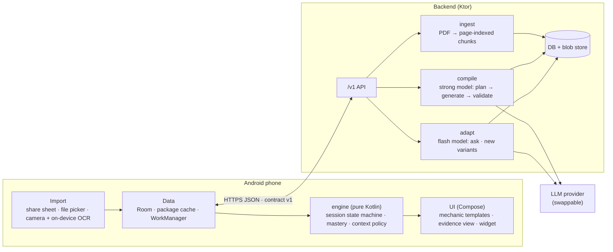

# Anything2Game

> Anything you have to read, playable in five minutes — and every answer points back to the page.

CSI301 Mobile Computing group project. Everything is due **2026-12-07** (ad + demo video, group report + code, individual reports).

## Repository map

| Path | What it is | Main owners | Build |
|---|---|---|---|
| `docs/` | All documents — index in [docs/README.md](docs/README.md) | everyone | — |
| `contract/` | **The single client↔server contract**: Kotlin DTOs, JSON examples, validators | architecture lead; changes need both sides to review | `./gradlew :contract:test` |
| `android/` | Android app (Kotlin + Compose). `:engine` = pure-Kotlin game engine, `:app` = UI and platform features — see [android/README.md](android/README.md) | Android team | `./gradlew :android:app:assembleDebug` |
| `server/` | Backend (Kotlin + Ktor): ingest, package compilation, live adaptation — **not started** | backend team | `./gradlew :server:run` (planned) |
| `samples/` | Licensed sample materials + reviewed offline packages (demo fallback, always labelled "pre-generated") | content reviewer | — |
| `tools/` | Scripts: batch generation evals, sample refresh | backend team | — |

## How the parts talk

Details: [docs/architecture/ARCHITECTURE.md](docs/architecture/ARCHITECTURE.md).

## Ground rules

1. An interface change starts in `contract/` (DTO + example + test); both sides run the same example tests.
2. API keys live only on the server — never in the APK, never in git.
3. Pre-generated or mock content is labelled as such in the UI and in the video.
4. Course rule: **AI may be used heavily for code; the app design, reports and demo must be the team's own work.** AI-assisted drafts in `docs/` are internal discussion material — the team makes the decisions and writes the report in its own words.
