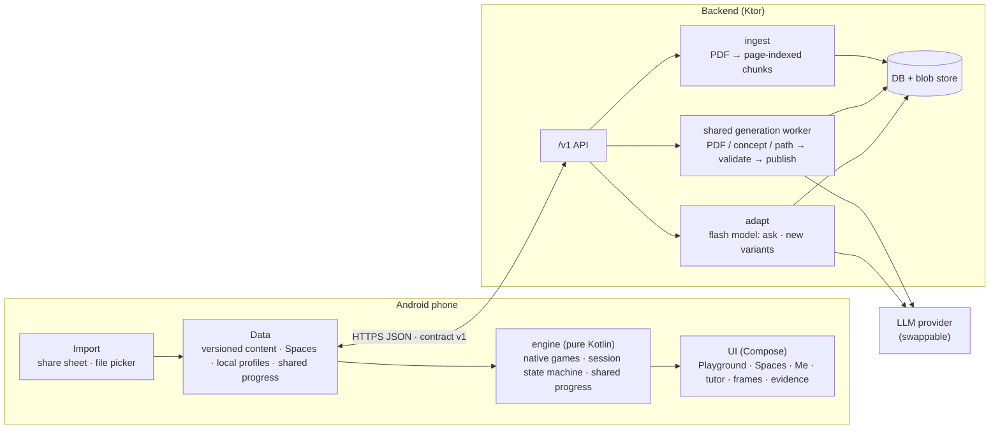

# Anything2Game

> Explore a concept by playing; turn your readings into a route you can return to.

CSI301 Mobile Computing group project. Everything is due **2026-12-07** (ad + demo video, group report + code, individual reports).

## What the app does (2026-11-24)

| Tab | What happens |
|---|---|
| **Spaces / 学习空间** (default) | Each Space holds your readings (PDFs or course packs) and a **Duolingo-style learning map**: one coloured unit per chapter and a winding path of round steps that show done / current / locked. The current step has a "Start" bubble with your character beside it. Tap a step to get a card with its kind, minutes and source page. The steps are the visual-novel **explainer** (Aya walks you through the concept, every line with its page) and **practice** in a game frame (Classic / Case / Rookie / Escape: swipe, drag-sort, drag-order, cross-examine, verdict stamps). |
| **Playground / 游乐场** | **10 pixel-art concept games** (EN/ZH) on two native mechanics. **Partition**: git bisect, guess the number, a dictionary, "which layer broke", a locker search. **Allocation**: comparative advantage, revision time, a GPU budget, a farm, two workshops. Each has a practice round, a changed-condition transfer round, stars and a source card. **＋ Add a game** plays the generation sequence and opens the matching pre-generated game, labelled *Demo · pre-generated*. The demo never generates live. |
| **Me / 我的** | Nickname and character (Mochi / Pip / Kumo), learning days and progress across Spaces and games, switch profile (sample student **Lin** / guest), and an opt-in *Pause when I'm walking*. |

Content ships as checksummed **content packs** in one format for presets, server output and imports. A shared deterministic game runtime runs on both phone and server. The phone never calls a model provider; real generation (PDF → route, concept → game) runs on our server and is not used in the demo.

**Start here:** [product state](docs/product/PRODUCT.md) · [architecture: games and Spaces](docs/architecture/concept-games-spaces.md) · [source viewer](docs/architecture/source-viewer.md) · [screens: map](docs/design/screens/spaces-map/) · [screens: playground](docs/design/screens/playground/).

## Quick start

```sh
# JDK 21 + Android SDK platform 37 (local.properties → sdk.dir)
./gradlew :contract:test :android:engine:test :android:app:testDebugUnitTest :server:test
./gradlew :android:app:lintDebug
./gradlew :android:app:assembleDebug             # APK → android/app/build/outputs/apk/debug/app-debug.apk
adb install -r android/app/build/outputs/apk/debug/app-debug.apk
```

### Demo build: the real papers

"Show source" opens the **original PDF** for the Attention and ResNet demo courses. The papers are not in git: the debug build downloads them from arXiv, checks each against the SHA-256 the course was measured on, caches them in `~/.gradle/caches/a2g-sample-pdfs`, and puts them in the APK. If a download fails (offline, a changed file), the app still works but shows the extracted text instead, and the **end of the build prints a boxed `Demo papers: NOT in this APK` summary**.

| Build | Command | Papers |
|---|---|---|
| Normal | `./gradlew :android:app:assembleDebug` | fetched; a boxed summary at the end says which are in or missing |
| For the team / the demo video | `./gradlew :android:app:assembleDebug -Pa2g.samplePdfs=required` | **build fails** if any paper is missing |
| Shared outside the team | `./gradlew :android:app:assembleDebug -Pa2g.samplePdfs=false` | left out on purpose (the papers are third-party) |

Check an APK: `unzip -l android/app/build/outputs/apk/debug/app-debug.apk | grep sample-pdfs` should list `demo_attention.pdf` and `demo_resnet.pdf`. Unit tests never bundle them. See [the source viewer](docs/architecture/source-viewer.md).

Demo path for the video (offline, presets only):
1. **Continue as Lin.** Spaces opens on the Attention map, part-way done. Tap the current step → **Start** → Aya's explanation → back: the map has advanced.
2. Tap a practice step and play it as a **Case**: drag-sort, then cross-examine the AI summary. Case closed.
3. **Playground**: play *Hunt the broken commit* (partition) and *Wine or cloth?* (drag workers onto the vineyard and the looms) through the transfer round for stars.
4. **＋ Add a game**: type "机会成本" or "git bisect". The generation sequence plays, then the matching demo game opens.
5. **Me**: the same progress, the character and the profile switch.

Uploading PDFs and generating new activities need the API: see [server setup](server/README.md) and [protocols and recovery](docs/architecture/concept-games-spaces.md). The existing Learn and Practice preferences both migrate to Spaces. Historical mastery without a known content version stays history.

## Repository map

| Path | What it is | Main owners | Build |
|---|---|---|---|
| `docs/` | All documents — index in [docs/README.md](docs/README.md) | everyone | — |
| `contract/` | **The single client↔server contract**: Kotlin DTOs, JSON examples, validators | architecture lead; changes need both sides to review | `./gradlew :contract:test` |
| `android/` | Android app (Kotlin + Compose). `:engine` = pure-Kotlin game engine, `:app` = UI and platform features — see [android/README.md](android/README.md) | Android team | `./gradlew :android:app:assembleDebug` |
| `server/` | Backend (Kotlin + Ktor): ingest, compile pipeline, 5 frame nodes, ask — see [server/README.md](server/README.md) | backend team | `./gradlew :server:run` (loopback, fake LLM by default) |
| `infra/` | Terraform: `modules/aws-service` (CloudFront+WAF → internal ALB → Fargate → RDS, Cognito), `envs/demo-aws` — see [infra/README.md](infra/README.md) | architecture lead | `infra/scripts/check.sh` |
| `samples/` | Pre-generated demo courses as JSON (package, frames, `tutor.demo.*` explanation scripts). Packed into `assets/packs/*.a2gpack` at build time ([ADR-017](docs/architecture/content-packs.md)) and always labelled "pre-generated" | content reviewer | `./gradlew :contract:test` validates them |
| `tools/` | `eval/`: generation-quality harness (Bedrock, local only). `tutor/`: pre-generates explanation scripts for preset courses (needs human review) | backend team | see `tools/eval/README.md` |

## How the parts talk



Details: [docs/architecture/ARCHITECTURE.md](docs/architecture/ARCHITECTURE.md).

## Ground rules

1. An interface change starts in `contract/` (DTO + example + test); both sides run the same example tests.
2. API keys live only on the server — never in the APK, never in git.
3. Pre-generated or mock content is labelled as such in the UI and in the video; pre-generated explanation scripts are reviewed by a person before filming.
4. Every member codes and presents their own part in the video (course rule).
5. Course rule: **AI may be used heavily for code; the app design, reports and demo must be the team's own work.** AI-assisted drafts in `docs/` are internal discussion material — the team makes the decisions and writes the report in its own words.
