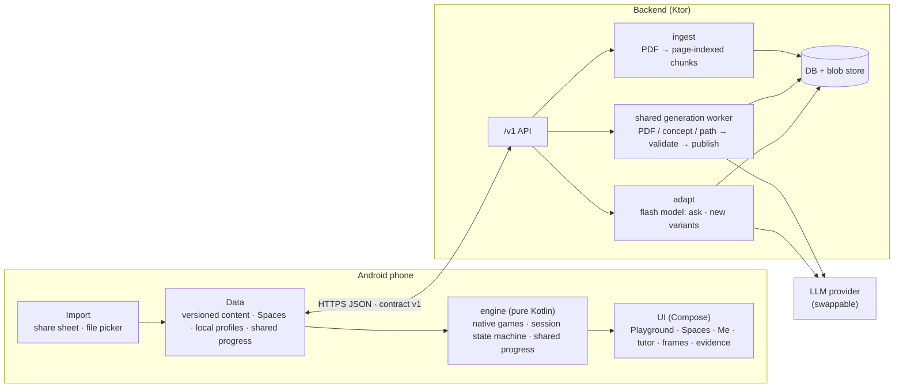

# Anything2Game

> Explore a concept by playing; turn your readings into a route you can return to.

CSI301 Mobile Computing group project. Everything is due **2026-12-07** (ad + demo video, group report + code, individual reports).

## Concept games and learning Spaces (2026-11-23)

The API edition now has three entrances. Implementation, test results, screenshots and known limits are recorded in the [acceptance record](docs/design/concept-games-spaces-acceptance.md).

| Tab | What happens |
|---|---|
| **Playground / 游乐场** | Explore a concept through a native game, without uploading a PDF. The first mechanisms are information partition and finite resource allocation, each with a changed-condition transfer challenge. Installed reviewed games work offline; supported concept generation uses the server. |
| **Spaces / 学习空间** (default) | One card per learning Space, with multiple PDFs and a route through grounded explanation, light practice and the existing Classic / Case / Rookie / Escape activities. Materials remain directly accessible. |
| **Me / 我的** | Local nickname and character, shared learning-day and progress records, historical learning and profile switching. |

The server and Android use one typed content contract, pack codec and deterministic game runtime. One transport handles the client's API calls; the existing worker and model router handle both PDF and concept generation. There is no additional deployed microservice or model-written executable code.

Generation currently accepts reviewed topics for **binary search / 二分查找** and **opportunity cost / 机会成本**. Other concepts return an explicit unsupported result. Presets and fake-provider artifacts retain their labels. The phone never calls a model provider directly.

**Start here:** [product state](docs/product/PRODUCT.md), [approved design and three-repository research](docs/superpowers/specs/2026-11-23-concept-games-spaces-design.md), [implemented architecture and protocols](docs/architecture/concept-games-spaces.md).

## Quick start

```sh
# JDK 21 + Android SDK platform 37 (local.properties → sdk.dir)
./gradlew :contract:test :android:engine:test :android:app:testDebugUnitTest :server:test
./gradlew :android:app:lintDebug
./gradlew :android:app:assembleDebug             # APK → android/app/build/outputs/apk/debug/app-debug.apk
adb install -r android/app/build/outputs/apk/debug/app-debug.apk
```

Offline demo path:
1. Continue as **Lin** and open a Space to resume the saved ResNet case or the Attention explanation.
2. Open **Playground** and play a reviewed partition or resource-allocation game through its transfer challenge.
3. Open **Me** to inspect the same local learning records.

Uploading PDFs and generating new activities need the API: see [server setup](server/README.md) and [protocols and recovery](docs/architecture/concept-games-spaces.md). The existing Learn and Practice preferences both migrate to Spaces. Historical mastery without a known content version stays history.

## Repository map

| Path | What it is | Main owners | Build |
|---|---|---|---|
| `docs/` | All documents — index in [docs/README.md](docs/README.md) | everyone | — |
| `contract/` | **The single client↔server contract**: Kotlin DTOs, JSON examples, validators | architecture lead; changes need both sides to review | `./gradlew :contract:test` |
| `android/` | Android app (Kotlin + Compose). `:engine` = pure-Kotlin game engine, `:app` = UI and platform features — see [android/README.md](android/README.md) | Android team | `./gradlew :android:app:assembleDebug` |
| `server/` | Backend (Kotlin + Ktor): ingest, compile pipeline, 5 frame nodes, ask — see [server/README.md](server/README.md) | backend team | `./gradlew :server:run` (loopback, fake LLM by default) |
| `infra/` | Terraform: `modules/aws-service` (CloudFront+WAF → internal ALB → Fargate → RDS, Cognito), `envs/demo-aws` — see [infra/README.md](infra/README.md) | architecture lead | `infra/scripts/check.sh` |
| `samples/` | Pre-generated demo courses as JSON (package, frames, `tutor.demo.*` explanation scripts). Packed into `assets/packs/*.a2gpack` at build time ([ADR-017](docs/architecture/content-packs.md)) and always labelled "pre-generated" | content reviewer | `./gradlew :contract:test` validates them |
| `tools/` | `eval/`: generation-quality harness (Bedrock, local only). `tutor/`: pre-generates explanation scripts for preset courses (needs human review) | backend team | see `tools/eval/README.md` |

## How the parts talk



Details: [docs/architecture/ARCHITECTURE.md](docs/architecture/ARCHITECTURE.md).

## Ground rules

1. An interface change starts in `contract/` (DTO + example + test); both sides run the same example tests.
2. API keys live only on the server — never in the APK, never in git.
3. Pre-generated or mock content is labelled as such in the UI and in the video; pre-generated explanation scripts are reviewed by a person before filming.
4. Every member codes and presents their own part in the video (course rule).
5. Course rule: **AI may be used heavily for code; the app design, reports and demo must be the team's own work.** AI-assisted drafts in `docs/` are internal discussion material — the team makes the decisions and writes the report in its own words.
