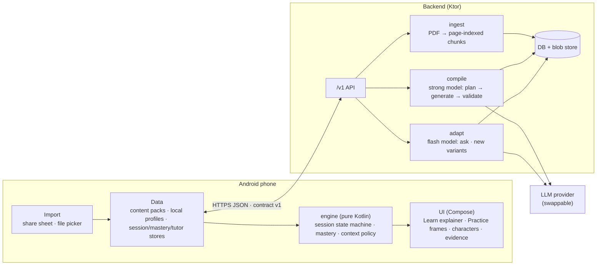

# Anything2Game

> Anything you have to read, playable in five minutes — and every answer points back to the page.

CSI301 Mobile Computing group project. Everything is due **2026-12-07** (ad + demo video, group report + code, individual reports).

## What the app does today (2026-11-20)

A student opens it as **Lin**, a sample student with a few days of history, or as a guest, and lands on three tabs:

| Tab | What happens |
|---|---|
| **Learn** (middle, default) | Pick what you care about (overview / method / results / limits). Answer 3–4 quick questions, where "I don't know" is fine. Then **Aya**, the explainer, walks you through the reading in a visual-novel scene: standee on top, dialogue below, tap to advance. You can Rephrase, ask for an Example, Ask a question or Continue, and every line has its page. Your own character sits on stage and reacts. |
| **Practice** | One card per course. **Play as** Classic (quick review), Case (catch the AI summary overclaiming, with the page), Rookie (teach a junior), or Escape (process readings). You swipe, sort and order by **drag and drop**, deduce, and cross-examine. Each answer gets a verdict stamp and its evidence; misses come back later as other versions of the clue. |
| **Me** | Nickname, character (Mochi / Pip / Kumo), progress, switch profile, and an opt-in *Pause when I'm walking*. |

Course content ships as **content packs** (`.a2gpack`: package + game frames + explanation script, checksummed). The same format covers presets, server output and imports. The phone never calls an AI API; generation runs on our server.

**Start here:** [docs/product/PRODUCT.md](docs/product/PRODUCT.md) (current state, video plan, open decisions). The latest team decisions are in [docs/product/team-review-2026-11-20.md](docs/product/team-review-2026-11-20.md).

## Quick start

```sh
# JDK 21 + Android SDK platform 37 (local.properties → sdk.dir)
./gradlew test                                   # contract, engine, app (Robolectric + journeys), server
./gradlew :android:app:assembleDebug             # APK → android/app/build/outputs/apk/debug/app-debug.apk
adb install -r android/app/build/outputs/apk/debug/app-debug.apk
```

Demo path for the video, offline and with no server:
1. Continue as **Lin**.
2. In **Practice**, resume the ResNet case, or Play as Case on Attention.
3. In **Learn**, start the Attention explanation (or the zh spaced-repetition course in Chinese).

Uploading your own PDF needs the local server: see [server/README.md](server/README.md) and [docs/design/document-tutor.md](docs/design/document-tutor.md).

## Repository map

| Path | What it is | Main owners | Build |
|---|---|---|---|
| `docs/` | All documents — index in [docs/README.md](docs/README.md) | everyone | — |
| `contract/` | **The single client↔server contract**: Kotlin DTOs, JSON examples, validators | architecture lead; changes need both sides to review | `./gradlew :contract:test` |
| `android/` | Android app (Kotlin + Compose). `:engine` = pure-Kotlin game engine, `:app` = UI and platform features — see [android/README.md](android/README.md) | Android team | `./gradlew :android:app:assembleDebug` |
| `server/` | Backend (Kotlin + Ktor): ingest, compile pipeline, 5 frame nodes, ask — see [server/README.md](server/README.md) | backend team | `./gradlew :server:run` (loopback, fake LLM by default) |
| `infra/` | Terraform: `modules/aws-service` (CloudFront+WAF → internal ALB → Fargate → RDS, Cognito), `envs/demo-aws` — see [infra/README.md](infra/README.md) | architecture lead | `infra/scripts/check.sh` |
| `samples/` | Pre-generated demo courses as JSON (package, frames, `tutor.demo.*` explanation scripts). Packed into `assets/packs/*.a2gpack` at build time ([ADR-017](docs/architecture/content-packs.md)) and always labelled "pre-generated" | content reviewer | `./gradlew :contract:test` validates them |
| `tools/` | `eval/`: generation-quality harness (Bedrock, local only). `tutor/`: pre-generates explanation scripts for preset courses (needs human review) | backend team | see `tools/eval/README.md` |

## How the parts talk



Details: [docs/architecture/ARCHITECTURE.md](docs/architecture/ARCHITECTURE.md).

## Ground rules

1. An interface change starts in `contract/` (DTO + example + test); both sides run the same example tests.
2. API keys live only on the server — never in the APK, never in git.
3. Pre-generated or mock content is labelled as such in the UI and in the video; pre-generated explanation scripts are reviewed by a person before filming.
4. Every member codes and presents their own part in the video (course rule).
5. Course rule: **AI may be used heavily for code; the app design, reports and demo must be the team's own work.** AI-assisted drafts in `docs/` are internal discussion material — the team makes the decisions and writes the report in its own words.
