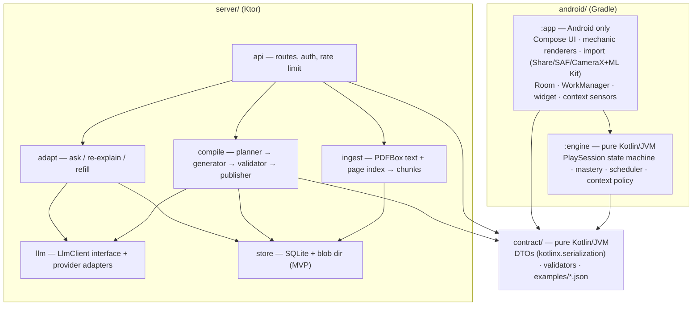
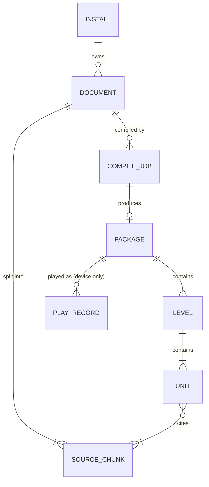
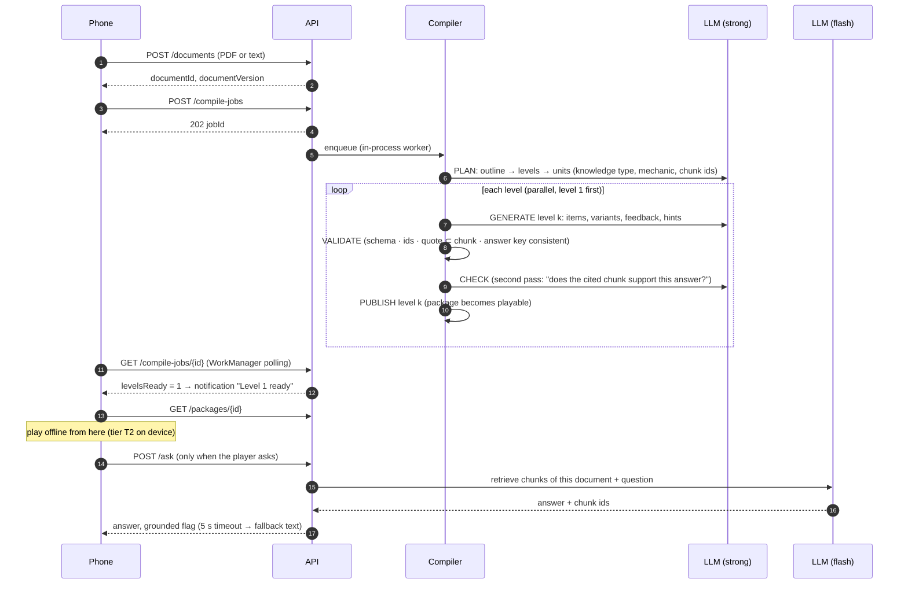
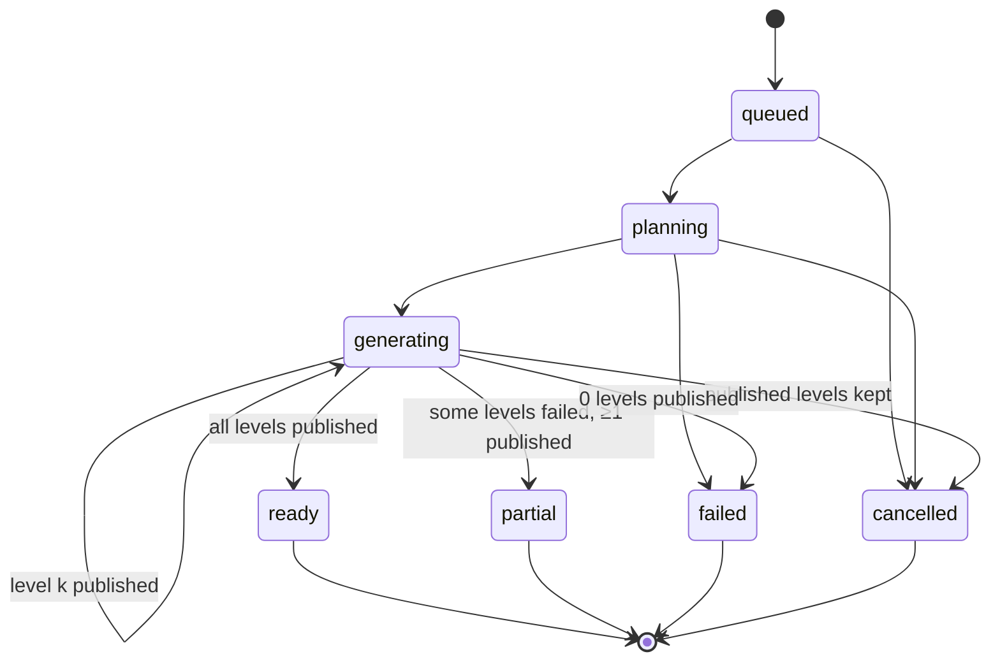
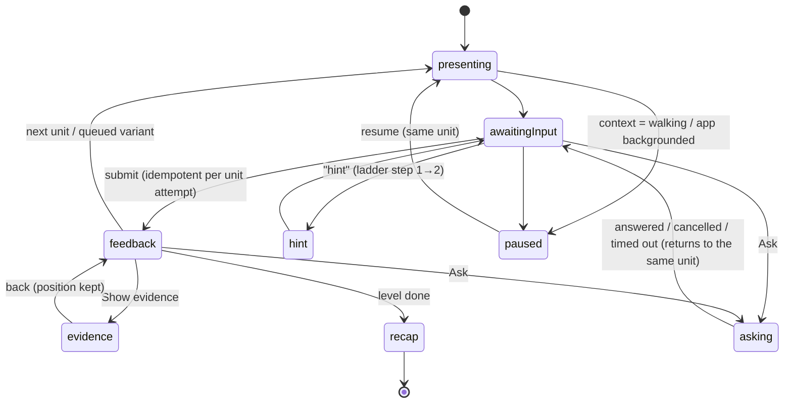

# Architecture

**Scope**: components, where they live, the contract between them, state machines, the generation pipeline, privacy/security, testing. Decisions and their reasons are logged in [decisions.md](decisions.md). Game rules are in [game-design.md](../product/game-design.md).

## 1. Components and ownership boundaries



| Module | Depends on | Must NOT depend on | Why the boundary |
|---|---|---|---|
| `contract` | kotlinx.serialization only | Android, Ktor | the one artefact both sides compile against; a breaking change fails both builds |
| `:engine` | `contract` | Android SDK | all game logic unit-testable on any JVM (including this VM with no emulator) |
| `:app` | `:engine`, `contract`, AndroidX | server code | UI and platform features only |
| `server` | `contract`, Ktor, PDFBox | Android | backend can be built and deployed alone |

All four are modules of **one root Gradle build** (`settings.gradle.kts` at repo root), so a contract change is compiled against both sides in one command.

## 2. Repository layout

```
anything2game/
├── README.md                  repo map + ground rules
├── settings.gradle.kts        includes :contract, :android:engine, :android:app, :server
├── docs/                      product · design · architecture · plan · research · testing · archive
├── contract/
│   ├── src/main/kotlin/…      DTOs + PackageValidator
│   ├── src/test/kotlin/…      golden tests over examples/
│   └── examples/              canonical JSON: valid + invalid cases (the spec by example)
├── android/
│   ├── engine/                pure Kotlin
│   └── app/                   Android application
├── server/
│   ├── src/main/kotlin/…      api · ingest · compile · adapt · llm · store
│   ├── src/main/resources/prompts/   versioned prompt templates
│   └── src/test/kotlin/…      FakeLlmClient-driven tests
├── samples/                   licensed materials + reviewed packages (offline demo fallback)
└── tools/                     eval scripts (generation quality over samples)
```

## 3. The contract (v1)

### 3.1 Entities



- **Document** — identified by `documentId`; `documentVersion` = SHA-256 of extracted text. Same text → same version → compile can be reused (dedupe).
- **SourceChunk** — `chunkId`, `pageIndex` (physical PDF page, 0-based), optional `pageLabel` (printed number), `text`. Citations point at chunks, and the client can always show the chunk text even if page jumping fails.
- **Package** — immutable once a level is published; `packageId` + `contentVersion`. Regeneration creates a new package; old progress stays on the old one.
- **Unit** — one knowledge point played through one mechanic: `mechanic`, `item` (shape depends on mechanic), `variants[]`, `hints[]`, `sourceRefs[]`.
- **PlayRecord** — progress and mastery, **stored on device only** (Room). Not sent to the server in the MVP.

Canonical example: [`contract/examples/package.v1.example.json`](../../contract/examples/package.v1.example.json).

### 3.2 HTTP API

| Method & path | Body → response | Notes |
|---|---|---|
| `POST /v1/installs` | `{}` → `{installId, token}` | anonymous; no accounts in MVP; token in `Authorization: Bearer` |
| `POST /v1/documents` | multipart PDF **or** `{kind: "text"\|"ocr", title, pages:[{pageIndex,text}]}` → `201 {documentId, documentVersion, pageCount}` | PDF extracted on server; text/OCR already extracted on device (images never uploaded) |
| `POST /v1/compile-jobs` | `{documentId, options:{minutesPerLevel, language}, clientRequestId}` → `202 {jobId}` | idempotent on `clientRequestId`; returns existing job/package if `documentVersion`+options already compiled |
| `GET /v1/compile-jobs/{jobId}` | → `{state, levelsReady, levelsPlanned, packageId?, error?}` | poll with backoff; `error.retryable` tells the client what to do |
| `POST /v1/compile-jobs/{jobId}/cancel` | → `{state}` | cancel can race with success; terminal state wins, client trusts the returned state |
| `GET /v1/packages/{packageId}` | → `Package` (published levels only) | `ETag: contentVersion`; client re-fetches when `levelsReady` grows |
| `POST /v1/ask` | `{packageId, unitId, question, clientRequestId}` → `{answer, sourceRefs[], grounded}` | flash model; retrieval limited to this document; `grounded=false` → "not in the material" + nearest chunk |
| `POST /v1/variants` | `{packageId, unitId, missedOptionIds[]}` → `{variants[]}` | flash refill; validated like compile output |
| `DELETE /v1/documents/{documentId}` | → `204` | deletes file, chunks, packages, jobs — the privacy promise |

Errors: `{error:{code, message, retryable}}` with codes like `FILE_TOO_LARGE`, `NO_TEXT_LAYER`, `ENCRYPTED_PDF`, `QUOTA_EXCEEDED`, `MODEL_TIMEOUT`.

## 4. Generation pipeline (tier T1 compile, tier T3 adapt)



Validation gates (a level is published only if all pass):

| Gate | Checks | On failure |
|---|---|---|
| Schema | types, required fields, mechanic-specific shape, unique ids | regenerate that unit once, then drop it |
| Reference | every `sourceRef` exists; every quoted span is a substring of its chunk (normalised whitespace) | drop the unit |
| Consistency | exactly one correct answer (Deduce), every card has a bin (Sort), feedback exists per option | regenerate once |
| Support | second LLM pass judges whether the chunk supports the answer | mark `review: flagged`; excluded from the demo set unless a human approves |
| Level | ≥3 units survive, ≥2 mechanics | merge with next level or fail the job |

Prompts are versioned files in `server/src/main/resources/prompts/`; each package records `promptVersion` and `model` so quality changes are traceable.

## 5. State machines

### 5.1 CompileJob (server)



Guards: one active job per (`documentVersion`, options). A late model response after `cancelled` is discarded. `failed` carries `retryable`.

### 5.2 PlaySession (phone, `:engine`)



Every transition is persisted (Room) before the UI moves on, so process death or rotation resumes at the same state. The prototype already does this with SharedPreferences for a single step; the engine generalises it.

### 5.3 UnitMastery (phone)

`new → box0 ↔ box1 ↔ box2 → box3(solid)`; wrong at any box → `box0` + variant queued; boss = units with box ≤1 whose due time has passed.

## 6. Android specifics

| Concern | Implementation |
|---|---|
| Import from anywhere | `<intent-filter>` for `ACTION_SEND` / `ACTION_VIEW` with `text/plain`, `application/pdf`, `image/*`; SAF `OpenDocument` for files; CameraX + ML Kit Text Recognition (on-device, Latin + Chinese models) |
| Long jobs | WorkManager `CoroutineWorker`: upload → create job → poll with backoff → download levels → notify. Constraints: network; unmetered for prefetch |
| Offline | Packages cached as JSON files + Room index; everything except Ask/compile works offline |
| Interruption | state persisted per transition; `SavedStateHandle` for UI state; resume card on cold start |
| Context | `ActivityRecognitionClient` transitions (needs `ACTIVITY_RECOGNITION` runtime permission, asked only when the user enables auto-pause); ConnectivityManager callbacks; BatteryManager |
| Glanceable review | App Widget (Glance) showing one boss item; tap → opens that unit |
| Permissions | none at install; camera, notifications and activity recognition requested in context, each with a reason screen |

UI toolkit: **Jetpack Compose** for new screens (gesture-heavy mechanics are much simpler than with Views). The prototype's Views screens are replaced as each Compose screen lands.

## 7. Security and privacy

| Topic | Rule |
|---|---|
| Secrets | LLM keys only in server env vars; APK holds only the server base URL |
| Transport | HTTPS only (network security config disallows cleartext except the local dev host) |
| Untrusted input | document text is data, never instructions: prompts delimit it, outputs are schema-validated, the model has no tools |
| Upload limits | type sniffing (not just extension), size and page caps, per-install rate limit and daily compile quota |
| Consent | before first upload: "your text is sent to an external AI provider"; cancel path |
| Data minimisation | images OCR'd on device; progress stays on device; server logs ids and states, not document text or questions |
| Deletion | `DELETE /v1/documents/{id}` and "Delete all my data" in settings |
| Hosting | personal/team cloud account, never a work account; before exposing the server publicly, review auth, rate limits and TLS |

## 8. Testing strategy (fits a VM with no emulator)

| Layer | Tool | Runs here? |
|---|---|---|
| contract | JUnit golden tests over `examples/` (valid parse, invalid rejected) | ✅ |
| engine | JUnit: state machine, mastery, scheduler, context policy | ✅ |
| server | Ktor test host + `FakeLlmClient` returning recorded responses; PDFBox on sample PDFs | ✅ |
| app logic | Robolectric | ✅ |
| app visuals | Roborazzi screenshot tests of Compose screens (PNG review) | ✅ |
| platform features (camera, share, activity recognition, widget) | real device checklist in `docs/testing/` | ❌ → real phone |
| generation quality | `tools/` eval: run compile over samples, report gate pass rates and flagged items | ✅ (needs a model key) |

## 9. Deployment (MVP)

One server process (Ktor fat JAR or container) + SQLite file + blob directory on a persistent disk. In-process worker pool for compile jobs — no queue service yet; the job table *is* the queue, so a restart resumes `queued` jobs. Upgrade path when needed: Postgres, object storage, a separate worker — none of it changes the contract.

LLM provider is behind `LlmClient`; choose by (a) where the server runs and whether phones in mainland China can reach both, (b) structured-output support, (c) cost of strong vs flash tier. Decision recorded in decisions.md once tested.
