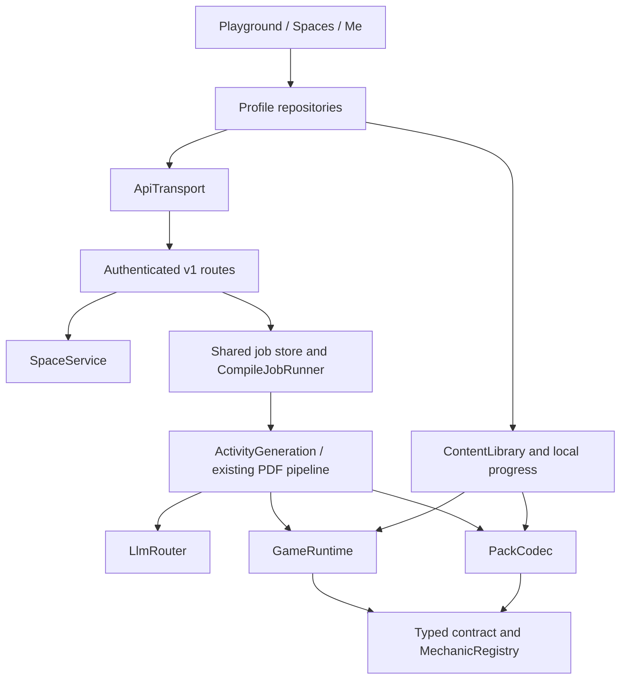

# Concept games and PDF Spaces

**Scope:** The API edition's shared game runtime, versioned content and Space generation interfaces. This is an implementation reference for the 2026-11-23 update. Device acceptance and screenshots are recorded separately; the earlier [research and design](../superpowers/specs/2026-11-23-concept-games-spaces-design.md) explains the product choices.

## Responsibilities

The application remains a modular monolith: one Android client and one Ktor service. Services use ordinary Kotlin interfaces inside the process and the shared HTTP contract across the network. There is no additional gateway, message broker or separately deployed game service.



| Responsibility | Authoritative implementation |
|---|---|
| Wire DTOs, typed evidence, game/path schemas and capability bounds | `contract/game`, `contract/space`, `contract/progress` |
| ZIP bounds, file inventory, sizes, checksums, v1/v2 dispatch | `contract/pack/PackCodec` |
| Legal actions, win/loss, deterministic replay, transfer and solvability | `android/engine/game/GameRuntime` |
| Completed activities, mastery, review states and historical learning dates | `android/engine/progress/ProgressProjection`, using the existing `LeitnerPolicy` |
| Client token, timeout, JSON/binary response and error handling | `android/app/data/api/ApiTransport` |
| Models and provider routing | Existing server `LlmRouter` and provider adapters |
| Queue polling, concurrency, heartbeat, cancellation and lease ownership | Existing server `CompileJobRunner` and job repository |
| Owned Space revisions, member receipts and generation admission | Server `SpaceService` and both store backends |

The engine is a pure JVM module despite its directory name. Server-only builds include `android/engine` and omit `android/app`; they do not require an Android SDK. Docker's build context includes the engine too.

## Supported games and generation

The first release supports information partition and finite resource allocation. These are stateful native mechanisms: choosing a partition removes candidates, and assigning a finite token changes production. Each game has a changed-condition transfer challenge. Neither a narrative label nor a Continue button can set the result independently of the reducer.

The reviewed knowledge provider accepts a bounded set of aliases, including `binary search`, `二分查找`, `opportunity cost` and `机会成本`. It uses the shared reviewed cards backed by the [NIST binary-search definition](https://xlinux.nist.gov/dads/HTML/binarySearch.html) and the [Federal Reserve Bank of St. Louis production-possibilities lesson](https://www.stlouisfed.org/-/media/project/frbstl/stlouisfed/education/lessons/pdf/production-possibilities-frontier-powerpoint-lesson.pdf). Game numbers are explicitly teaching settings. Unsupported topics return `UNSUPPORTED_TOPIC`; arbitrary web retrieval and executable model-written games are outside this release.

Generation uses reviewed knowledge or verified document activities, then asks the existing compile-tier model for an experience plan and typed game/path content. Common prompt rules include source boundaries, portrait/mobile interaction and the capabilities produced by `MechanicRegistry.describe()`. The runtime's supported mechanics are not separately handwritten in a client or prompt list. Invalid output receives a bounded repair attempt and must pass validation before publication.

The shared wrapper is [activity.v1.md](../../server/src/main/resources/prompts/activity.v1.md). The stage assignments are [activity-experience.v1.md](../../server/src/main/resources/prompts/activity-experience.v1.md), [game-spec.v1.md](../../server/src/main/resources/prompts/game-spec.v1.md) and [space-path.v1.md](../../server/src/main/resources/prompts/space-path.v1.md). The experience response names the objective, learner action, observable feedback and supporting evidence. This carries the researched action-to-result teaching pattern into a typed native runtime; it does not copy a desktop canvas or run the external repositories' generated JavaScript.

V2 model payloads reject unknown fields. Games also verify reviewed evidence, supported capabilities, executable traces and changed transfer conditions. The server builds and reads the final archive through the same codec and engine used by Android. A valid archive is a necessary publication condition, not a measurement of educational quality. Live-model quality still requires evaluation with configured providers.

The fake provider follows the same prompt and validation path. Its generation status and installed manifest carry `fixture=true` and its model ID. Bundled samples use `PackOrigin.PRESET`; generated archives use `SERVER`. Preserve this attribution offline.

## Playground presets and presentation themes

The Playground ships ten reviewed games per language (`ReviewedGames.catalog`): the original locker search and two workshops, plus git bisect, high-low guessing, dictionary lookup and deep-network layer faults on the partition mechanism, and comparative advantage, exam revision, a GPU budget and a two-crop farm on the allocation mechanism. Each has a practice and a changed-condition transfer stage and cites a reviewed source. Their numbers are invented teaching setups. They are packed as `PackOrigin.PRESET` archives by `PackTool`.

`PartitionConfig` and `AllocationConfig` carry an optional `theme` (`PartitionTheme`, `AllocationTheme`): item, zone, good and token nouns, an ask template containing `{n}`, and icon keys from `GameIcons`. A theme is presentation only. `StageConfig.rulesOnly()` drops it before a transfer is compared with its practice stage, an absent theme is not written, and a game without one renders with the neutral locker/zone wording, so older archives and checkpoints are unchanged. Chinese theme nouns carry their measure word.

"Add a game" on the Playground is a demonstration. It never calls the server: it plays a staged sequence (about three seconds, instant under reduced motion), matches the topic against the catalog aliases (`ReviewedGames.find`) and opens the matching preset, or offers the prepared games when nothing matches. Presets are labelled "Demo · pre-generated". Real server generation (`GenerationPanel`) remains available under the profile tab's demo controls.

Stars are derived from the recorded actions (`GameScore`): three for a clean stage, one fewer for each hint, retry, wasted question and every second undo, never fewer than one. The best result per profile is kept in `HomePreferences`.

## Space and generation API

All routes use the existing Bearer authentication and `ErrorBody/ApiError`. Ownership is derived from authentication. A body never selects another owner. Reads of another owner's records return 404.

| Method and path | Body / response |
|---|---|
| `POST /v1/spaces` | `CreateSpaceRequest` → Space, revision 1 |
| `GET /v1/spaces` | This owner's Spaces |
| `GET /v1/spaces/{id}` | Space with members, revision and active path |
| `PATCH /v1/spaces/{id}` | `RenameSpaceRequest` → current Space |
| `PUT /v1/spaces/{id}/members` | `SpaceMemberRequest` → current Space |
| `DELETE /v1/spaces/{id}/members` | Same typed JSON body; removes membership only |
| `POST /v1/generation-jobs` | `GenerationRequest` → 202 `GenerationStatus` |
| `GET /v1/generation-jobs/{id}` | Current state, stage, result and exclusions |
| `POST /v1/generation-jobs/{id}/cancel` | Current terminal or cancelled status |
| `GET /v1/content/{id}/versions/{version}` | Ready owned archive as `application/vnd.anything2game.pack+zip` |

The member body supports opaque local IDs without putting them into the URL:

```json
{
  "member": {
    "type": "server-document",
    "documentId": "doc_example",
    "documentVersion": "sha256:example"
  },
  "expectedRevision": 1,
  "clientRequestId": "add-document-1"
}
```

Use `type: "local-pack"` with `packageId` and `contentVersion` for local membership. It carries no URI, file bytes, text or chunks. The server checks owner and version for uploaded document members; local references remain metadata.

```json
{"input":{"type":"concept-game","topic":"二分查找","language":"zh"},"clientRequestId":"game-request-1"}
```

```json
{"input":{"type":"space-path","spaceId":"sp_example","expectedRevision":3,"language":"zh"},"clientRequestId":"path-request-1"}
```

Reuse the same request ID and body after an ambiguous network failure. Owner/operation/request-ID deduplication returns the existing result; a different target or body conflicts. A deliberate retry of terminal failed work uses a new request ID. `SPACE_STALE` requires reloading the current revision and reconsidering the edit. There is no fabricated percentage: states reuse `queued/planning/generating/ready/partial/failed/cancelled`, with a separate stage.

The existing `/v1/documents`, tutor, compile and package APIs remain available. The legacy document upload endpoint has no idempotency key; its uncertain-response recovery must be treated separately from a safely replayable generation submission.

## Path references and local materials

A server-generated path organizes actual owned, version-matching tutor and practice activities. It currently selects up to 16 introductory nodes, taking at most the first available tutor concept and first completed-package level per uploaded member. It can group and order those activities and establish prerequisites. It does not fabricate an activity ID or turn a plain uploaded document into an already generated lesson.

Practice references use package ID, content version and level ID. Tutor references use document ID, document version, the actual concept ID and an optional explicit session ID. New generated paths include the selected session. Local scripted lessons retain their own pack/edition session identity, so matching document labels cannot merge independent lessons or their progress. Old unqualified references bind only to a unique verified matching-language session; ambiguous references need refresh. PDF evidence always includes document/version/chunk, quote and page. Two documents may have a chunk called `c1` without sharing its identity.

A whole-game route reference names its final transfer completion activity. Earlier practice stages do not independently grant completion. A path containing a non-creditable game reference must be rejected before activation, rather than leaving a dependent node permanently locked.

Unavailable or local-only members appear in `excludedMembers`. An excluded local pack remains usable in the device's route, which keeps its existing tutor/practice nodes. An included dependency must resolve to an actual activity before the path is installed or opened. Tutor selection prefers the requested language and can use the other supported language’s existing session, retaining its actual concept, session and evidence. Practice selection scans lazily for the newest matching-language package, retaining the first valid alternative as fallback. A language switch does not make existing uploaded materials unavailable.

Space membership is mutable organization. A generated path and its content versions are immutable artifacts. Removing a relationship does not delete the document, installed pack or historical learning records. An active run remains pinned to its original content version.

## Learning map

The Route tab draws a Space's path as a winding map (`ui/space/RouteMap.kt` is the pure model, `RouteMapView.kt` the drawing). Nodes group into units by `PathNode.chapter`, otherwise by the material they come from. Each node's state comes from the existing progress projection: done, due for review, current (the first open step), open, locked (an unfinished prerequisite) or needs-update. Tapping an open node shows a sheet with its kind, minutes, cited page and the Start / Continue / Review button; tapping a locked node names the step to finish first.

A bundled course builds its path from itself (`data/learning/PresetRoute.kt`): one chapter per level, named by the level title. Each chapter explains the concepts that belong to the level (the level citing the most of a concept's passages, never earlier than the previous concept), then the level's practice. Every step needs the one before it. Case, Rookie and Escape are ways to play the same level and share its completion, so the practice step opens in the player's preferred frame instead of adding steps that could not be completed separately. Server-generated routes keep their own chapters and prerequisites; a fixture-made lesson shows a "Test content" badge on its unit, and old saved "(mock)" suffixes are not displayed.

## Queue and persistence guarantees

Flyway V3 preserves old compile records, permits source-free typed jobs, and scopes job deduplication by owner, operation and request ID. PostgreSQL owner and row locks order admission, revisions, cancellation, lease changes and publication. FileStore is a single-instance development store; a durable admission journal ties the job to absolute quota-counter values, so interrupted admission can replay without another debit.

Quota admission checks the owner and global budgets together. A global rejection cannot spend the owner's allowance. Recovery cleanup and publication both check the live, unexpired lease and nonterminal state. A delayed old worker cannot remove or publish over a replacement's result. Cancellation retains the concurrency slot until the underlying coroutine exits.

A path is readable only after its archive is written and its job is READY. Source deletion cancels dependent queued/running jobs and revokes affected historical path archives, including paths whose member was removed earlier. Revocation removes their downloadable bytes and invalidates active pointers without rolling Space revisions backward. Unreadable historical path archives fail closed during deletion; unrelated valid paths remain available. Publication rechecks the Space revision and source catalog. Two jobs generated from the same revision cannot both activate paths; a stale loser returns `SPACE_STALE` without a ready archive.

New game/path jobs publish one validated archive, not independently published partial stages. A ready path may explicitly exclude unavailable or local-only sources. The reused job enum also contains the legacy compile `PARTIAL` value; an unexpected partial new-activity result offers explicit whole-request regeneration, not a failed-part repair protocol. Each confirmed PDF import remains independently retryable without repeating successful siblings.

## Android persistence and recovery

The content library retains each installed version and resolves active sessions against that version. V2 game/path identities are immutable. A legacy v1 compile can append levels at the same version, provided all previous ordered levels and their referenced material remain unchanged. The directory installer validates staged archives before atomic publication.

Space and learning data belong to the active local profile; immutable installed archives are shared. A course is associated with an owned server document only through a receipt from an authenticated package response. The receipt binds the complete validated manifest to the document version and endpoint-scoped installation identity. It becomes durable before the archive is published. An unverified historical or imported course remains a local member. Existing local aliases continue to resolve after later verification, so a migrated Space keeps its content and identity.

Game actions, checkpoints and completion records use one atomic learning snapshot. Practice retains the existing engine's grading and uses a write-ahead transaction for absolute mastery changes, checkpoint and completion event. Tutor replies include a pending READ receipt in their cache write; recovery credits it idempotently. Individual corrupt historical tutor caches do not prevent unrelated progress from opening. The raw legacy mastery files remain untouched and are not inferred to belong to a current content version.

All current learning days derive from the same completion projection. Event records retain their actual time zone and local date; moving between Spaces does not duplicate global credit. Opening an activity, reading a reply and completing a changed-condition game challenge remain distinct outcomes.

Space edits and generation submissions retain durable request IDs. Definitive rejections expose retry or withdrawal; an ambiguous response reuses the original body and ID. PDF upload is the exception because the legacy upload endpoint has no idempotency key. The queue captures the selected tutor language with the confirmed batch so a resumed upload keeps the same language. It marks an upload as uncertain before dispatch and records the returned document before subsequent processing. After an unknown outcome it waits for an explicit decision to upload again. Configuration failures known to occur before dispatch allow ordinary retry.

Evidence resolution checks the exact profile document before looking for a matching retained preset edition. Automatic bundled copies use separate hash-keyed files, so they cannot overwrite an uploaded PDF even if an upload finishes during source lookup. PDF bytes are content-addressed and edition/attachment records publish atomically only after their matching bytes are durable. Legacy records remain readable; separate measured editions with the same extracted-text labels stay separate. Page geometry and citations retain their original document/content versions.

A Space-list refresh reuses one material inventory and progress snapshot across its cards. Installed generated/imported games and active runs remain reachable after a locale change; the locale selects bundled suggestions. Imported generator metadata is distinguished from authenticated generation provenance.

## Verification commands

```sh
./gradlew :contract:test :android:engine:test :server:test -Pa2g.samplePdfs=false
A2G_SERVER_ONLY=1 ./gradlew :server:installDist
```

PostgreSQL tests use Testcontainers by default. To use a dedicated disposable local server instead, explicitly supply `A2G_TEST_PG_ADMIN_URL`, `A2G_TEST_PG_USER` and optionally `A2G_TEST_PG_PASSWORD`. The harness creates and drops UUID-named test databases; use an isolated test server whose role may create databases. Without either option, PostgreSQL tests are skipped and must not be reported as exercised.

The implementation tests cover shared replay, strict pack validation, legacy v1 compatibility, ownership, stale revisions, source exclusion, lost leases, cancellation, admission interruption, cross-worker recovery and V2-to-V3 migration. Device rendering and provider quality are separate acceptance evidence.
