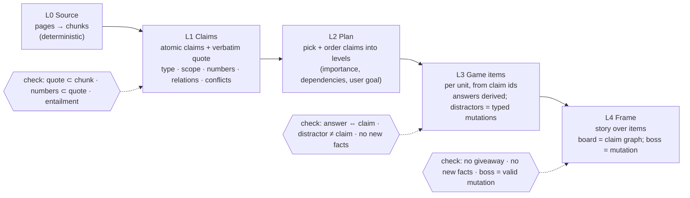

# Layered generation: source → claims → game → frame (proposal, 2026-11-18)

**Scope**: should generation be split into layers (e.g. PDF → fact layer → game layer), and does that raise or lower hallucination? Includes the contract between layers and an A/B experiment that decides adoption. Status: **proposed** (ADR-015 once the experiment passes).

## 1. Short answer

Layer — but **by who decides what is true**, not just by steps. Truth is decided **once**, close to the source, in small pieces that machines can check. Later layers may only *refer* to those pieces and change wording; they may not add facts. Under that contract layering **lowers** hallucination. Without it — each layer re-reading and re-summarising free text — layering **raises** it (the "telephone game": qualifiers drop, numbers drift, errors compound).

## 2. What the eval says about today's single-step generation

Today one call reads raw chunks and writes finished game items (question, answer, distractors, feedback, citations) at once. Every confirmed error came from that step doing two jobs at once — *understanding the source* and *writing a game*:

| Error seen | Type | Where truth was decided |
|---|---|---|
| MapReduce: 891 s vs 1 057 s, "faster" marked unsupported | misread (wrong verdict) | inside item writing |
| Order units with sequences the paper never states | invented structure | inside item writing |
| Attention: 41.8 (abstract, table) vs 41.0 (prose) used as a "flawed" claim | source conflict not detected | nowhere |
| Companion lead-ins revealing the answer | design error (not a hallucination) | frame writing, no check |

None of these is caught by today's validators, because they check *structure* (ids, quotes are substrings), not *meaning*.

## 3. The layers

| Layer | Contains | Decides truth? | Checks |
|---|---|---|---|
| **L0 Source** | page-indexed chunks (exists) | — | deterministic |
| **L1 Claims** — call it *claims*, not *facts*: it is what **the document says**, which may be wrong or self-contradictory | `claimId`, verbatim `quote` + `chunkId`, `text` (a faithful restatement), `type` (definition, number, comparison, causal, sequence, limitation, example, logistics), `scope` (the qualifiers: "on CIFAR-10", "at 3 pm", "single model"), `numbers` (copied verbatim), `importance` 1–3, `relations` (supports, contrasts, part-of, before/after), `conflictsWith` | **yes — only here** | quote is a substring (exists); every number in `text` appears in `quote` (deterministic); flash-tier entailment "does the quote say this?" per claim (small, reliable); same-subject claims with different numbers → `conflictsWith`, both excluded from questions |
| **L2 Plan** | levels as ordered claim ids | no | every claim id exists; sequence units only if a `sequence` claim exists |
| **L3 Game items** | items that **reference** claim ids; correct answers come from claims; each distractor is a **typed mutation** of a claim (`overgeneralise_scope`, `swap_number`, `reverse_cause`, `wrong_order`, `swap_entity`, `drop_limitation`) | no — wording only | correct option entails its claims; distractor's mutation actually changes the claim; **no new facts**: any number/named entity in item text must appear in the referenced claims (deterministic diff), except inside declared mutations |
| **L4 Frame** | dialogue, rooms, board, boss — over items and claims | no | lead-ins must not contain the unit's answer claim (string/entailment check); no new facts (same diff); Case boss = an `overgeneralise_scope` (or other) mutation of a real claim — the Summary's overclaim *is* a mutation |

## 4. Why this reduces hallucination (and where it could still go wrong)

**Reduces**:
- Each truth decision is one claim against one quote — a small, checkable unit. Checking a whole finished item ("is everything in this card right?") is much harder for both models and validators.
- Later layers keep the **verbatim quote** attached; they never see only a paraphrase, so qualifiers and numbers survive.
- Distractors stop being "plausible-sounding wrong text" and become **declared mutations** — we know *how* each is wrong, so feedback can name the misconception ("you generalised beyond the 3 pm reading").
- Source conflicts become visible (`conflictsWith`) instead of silently turning into bad questions.

**Still risky** (and the guard):
| Risk | Guard |
|---|---|
| Claim extraction itself misreads | entailment check per claim; drop low-confidence claims (precision over recall) |
| Restatement drops a qualifier | `scope` field is mandatory for number/comparison/causal claims; game text must keep the scope (check) |
| Over-atomising loses the argument (why → therefore) | `relations` between claims; L2 keeps chains together in one level |
| More calls = more latency/cost | L1 runs **once** per document and replaces most of today's plan step; L3/L4 then read claims, not the document (today frames re-send the whole document: 72 % of input tokens) |
| The checker model is wrong too | checks are small and mostly deterministic; the judge in `tools/eval` measures the residual |

Related approaches (to cite in the report after checking): atomic-fact decomposition for factuality evaluation (FActScore, Min et al., 2023) and verify-then-answer generation (Chain-of-Verification, Dhuliawala et al., 2023) `[verify]`.

## 5. What else the claim layer buys

| Gain | How |
|---|---|
| **Faster first value** | claims of page 1–3 exist within seconds → a "case-file preview" while games compile; units generate in parallel per claim group |
| **Cheaper** | frames, variants, Ask and refills read claims + quotes, not the document |
| **The evidence board is real** | board nodes = claims, edges = `relations` — no longer invented by the frame writer |
| **User goal steering** | *Exam / Seminar / Gist* reweights `importance` × `type` (e.g. exam → numbers, definitions; seminar → limitations, comparisons) |
| **Slides** | one claim set per slide; `logistics` type filtered out unless the material is a syllabus |
| **Mastery across documents** | mastery per claim; the boss review pulls shaky claims, not just shaky units |
| **Debuggable** | when an item is wrong we can see whether the claim or the item writing was wrong |

## 6. Contract and storage

- New artefact `ClaimSet` (`a2g.claims/v1`) per `documentVersion`: immutable, cached, validated like packages; `LearningUnit` gains optional `claimIds`, distractors/cards/statements gain optional `{claimId, mutation}` — additive, v1-compatible.
- The app never needs the claim set to play, but may download it for case notes and the board.
- Server: `ClaimNode` (L1) → `PlanNode` (now selects claims) → `UnitNode` per unit (L3, parallel) → `ValidateNode` (+ claim checks) → frame nodes read units + claims.

## 7. Decide by experiment, not by argument

| | A — today | B — layered |
|---|---|---|
| Pipeline | plan → level → validate/repair | claims (+checks) → plan → per-unit items (+checks) |
| Corpus | the same 5 documents (`tools/eval/corpus.json`) + 2 more slide decks | same |
| Generator / judge | Claude Sonnet 5 / GPT-5.6 Terra, judge rubric v2 | same |

Pre-registered outcome → meaning:

| Outcome | Meaning | Decision |
|---|---|---|
| B grounded ≥ A + 0.5 **and** human-verified factual errors at most half of A's, cost ≤ A | layering works as argued | adopt (ADR-015) |
| B better on errors but slower/costlier | trade-off | adopt claims + checks, keep a larger generation step |
| B ≈ A | the bottleneck is not where truth is decided | keep A; add the support gate only |
| B worse | telephone effect dominates | reject; record why |

Human verification: two team members independently label a stratified sample of 20 units per arm (blind to arm) for "wrong answer vs source"; the judge's numbers are only trusted where they agree with humans.
