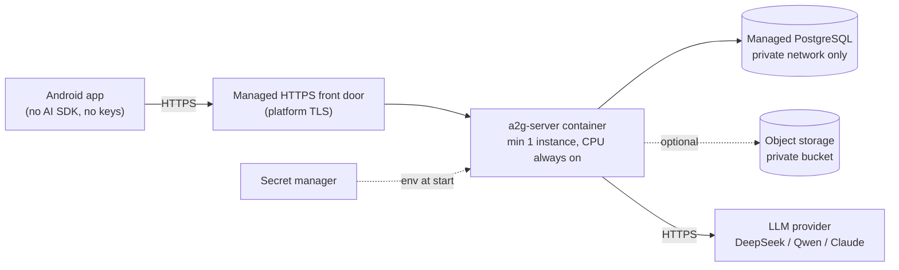

# Decoupling and multi-cloud audit (2026-11-18)

**Scope**: can each part be replaced without touching the others, and can the server run on Google Cloud, AWS or Alibaba/Kingsoft Cloud with only infrastructure changes? Covers the server and the client↔server boundary. Decision: [ADR-012](decisions.md), [ADR-013](decisions.md).

## 1. Verdict

The **code-level seams are good** (contract, LLM providers, storage interface, config); the server is **not yet deployable to a managed cloud runtime** because its state lives on local disk and in process memory. Four P0 fixes make it cloud-portable; none requires a cloud SDK.

## 2. Seams, one by one

| Seam | Today | Coupled to? | Verdict |
|---|---|---|---|
| Client ↔ server | `contract` module, HTTP JSON, both sides compile the same DTOs | nothing | ✅ |
| App ↔ AI provider | none; build guard forbids it (ADR-013) | — | ✅ enforced |
| Server ↔ LLM provider | `LlmClient` + router per tier; fake / OpenAI-compatible (DeepSeek, Qwen) / Anthropic SDK; chosen by env | nothing | ✅ |
| Configuration & secrets | env vars only, `Secret` type never prints | nothing — every platform injects env from its secret manager (Secret Manager, Secrets Manager, KMS) | ✅ |
| Persistence | `Store` interface, one implementation: `FileStore` (JSON on local disk) | **the instance's disk** | ❌ P0 — managed runtimes have ephemeral disks; two instances would not see each other's data |
| `Store` shape | one interface for installs, documents, jobs, packages, frames | — | ⚠️ P1 — split by aggregate (interface segregation) so e.g. packages can move to object storage alone |
| Background jobs | coroutines in the request process; recovered by scanning jobs at start | **one long-lived process with CPU between requests** | ❌ P0 — serverless runtimes may throttle CPU after the response and scale to zero |
| Job/publish locking | in-process `Mutex` | **a single instance** | ❌ P0 — replace with conditional updates in the database |
| Global cost guards | in-memory counters | **a single instance** | ⚠️ P1 — move to the database (per-install quotas already persist) |
| Packaging | Gradle `installDist`; no image | — | ❌ P0 — add a container image (the unit every cloud runs) |
| Port | `A2G_PORT` | — | ⚠️ P1 — also honour `PORT` (Cloud Run / App Runner convention) |
| Logs | plain text to stdout | nothing | ⚠️ P2 — JSON lines so Cloud Logging / CloudWatch / SLS parse fields |
| Health | `GET /v1/health` | nothing | ✅ (P2: separate readiness that checks the DB) |
| PDF parsing | in process, unbounded time | — | ⚠️ P1 — time limit per document |

## 3. Target shape (same on every cloud)

| Building block | Google Cloud | AWS | Alibaba Cloud |
|---|---|---|---|
| Container runtime | Cloud Run (min instances 1, CPU always allocated) | App Runner or ECS Fargate + ALB | Serverless App Engine (SAE) or ECS |
| PostgreSQL | Cloud SQL (private IP) | RDS (private subnets) | ApsaraDB RDS for PostgreSQL |
| Object storage (optional) | GCS | S3 (Block Public Access on) | OSS |
| Secrets → env | Secret Manager | Secrets Manager | KMS Secrets Manager |
| Image registry | Artifact Registry | ECR | ACR |
| Terraform provider | `hashicorp/google` | `hashicorp/aws` | `aliyun/alicloud` |

The **container contract** is the whole interface between code and infrastructure: one image, listens on `$PORT`, reads `A2G_*` env (DB URL, provider, model, keys from the secret manager), is stateless, logs to stdout, answers `/v1/health`.

## 4. Region and reachability — decides the demo cloud

| Question | Consequence |
|---|---|
| Can phones in mainland China (campus, the marker's phone) reach it? | Google consumer services are blocked in mainland China (confirmed); whether `*.run.app` / Cloud Run is blocked is **not confirmed either way** (k3 #7) → test on campus Wi-Fi before choosing GCP. AWS and Alibaba Hong Kong / Singapore regions are usually reachable. |
| Can the server reach the model? | DeepSeek / Qwen: reachable from Hong Kong/Singapore. Anthropic's API is **not offered in mainland China or Hong Kong (confirmed, Supported Regions Policy)** → Claude only from a region where it is offered, or keep Claude to dev evals (ADR-011). |
| Mainland region? | Needs ICP filing for a domain: Aliyun states 1–2 + 1–2 working days of review plus 1–20 working days at the provincial authority (k3 #8) — too risky for 2026-12-07. |

**Recommendation**: demo on **AWS or Alibaba Cloud, Hong Kong/Singapore region**, with DeepSeek/Qwen in production; keep a Google Cloud module as the second target to show portability. Use a personal or team account — never a work account.

## 5. Fix plan

| P | Fix | Where | Effort |
|---|---|---|---|
| P0 | `PostgresStore` (JDBC + Flyway migrations; packages/frames as JSONB) behind the existing `Store`; `FileStore` stays for local dev and tests; same test suite runs against both (Testcontainers locally) | `server/store` | M |
| P0 | Replace the in-process `Mutex` with conditional updates (`UPDATE … WHERE state NOT IN terminal`) — cancel/publish races become database guarantees | `server/compile` | S |
| P0 | Job queue on the jobs table (`SELECT … FOR UPDATE SKIP LOCKED`), worker loop in the same container; deploy with min 1 instance and CPU always on | `server/compile` | S |
| P0 | `Dockerfile` (multi-stage, JRE, non-root user, `PORT`), image built in CI | `server/` | S |
| P1 | Split `Store` into `InstallRepository`, `DocumentRepository`, `JobRepository`, `PackageRepository` | `server/store` | S |
| P1 | `BlobStore` port (local FS, S3-compatible) for raw uploads if we ever keep originals | `server/store` | S |
| P1 | Global cost guards in the DB; honour `PORT`; PDF parse time limit | `server/api`, `config`, `ingest` | S |
| P1 | `infra/terraform/modules/aws-service`, `gcp-service` (+ `alicloud-service` if chosen), `envs/demo` | `infra/` | M |
| P2 | JSON logs, readiness probe, request ids in logs | `server/` | S |

Before any `terraform apply` that creates a public endpoint: the API is a public API by design (anonymous app users), so the HTTPS front door is public; the database and bucket stay private; quotas and the install token are the abuse controls. That apply is the owner's go-ahead, after reviewing the plan output.

## 6. Two meanings of "multi-cloud" (note, 2026-11-18)

| | Portable multi-cloud (what we build) | Interconnected multi-cloud |
|---|---|---|
| Question | can the *whole* system run on cloud A **or** cloud B? | do parts on cloud A and cloud B talk **privately** at the same time? |
| Mechanism | one container contract + one Terraform module interface per cloud (ADR-012) | private network links between VPCs, e.g. **AWS Interconnect – multicloud** (managed, dedicated-bandwidth, encrypted links from Amazon VPC / Transit Gateway / Cloud WAN to Google Cloud, Azure, OCI; open API spec at github.com/aws/Interconnect) |
| Needed for us now? | yes — avoid lock-in, demo region choice | no — our only cross-provider traffic is public HTTPS model APIs |
| When it would matter | — | B2B: a school keeps materials in its own Google Cloud and our AWS service must read them without the public internet; or a model served from a private endpoint in another cloud |

Good report/presentation point: we chose portability (cheap, now) and know the path to interconnection (when a customer's data lives in another cloud).
