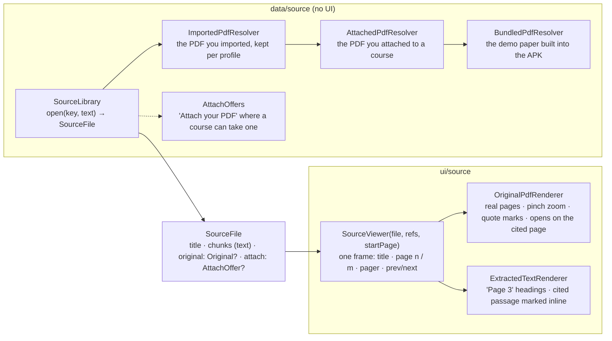

# One source viewer

Whenever the app shows "where this comes from", it opens **one viewer**, and that viewer asks **one library** for the file. A source looks the same from Practice, the explainer, Materials, a route step and a game.

## The shape

- **Port and chain** (`data/source/SourceLibrary.kt`, `OriginalResolvers.kt`). `SourceKey(documentId, documentVersion, course?)` says which file is meant. `ResolvingSourceLibrary` walks an ordered list of `OriginalResolver`s; the first one that has the file wins, and a resolver that throws counts as "not here". `phoneSourceLibrary(...)` is the one list the app uses (import, then attached, then bundled); `AppDependencies` exposes it as `deps.sources`.
- **Original** is a sealed type. Today: `Original.Pdf(SourceDocument)`.
- **Viewer** (`ui/source/SourceViewer.kt`). One frame (tag `source_viewer`) and one renderer chosen from `file.original`. Test tags are the same for every caller: `source_title`, `source_page_label`, `source_prev`, `source_next`, `source_close`, `source_loading`.
- **Text layout is not a fake page.** With no original it prints the extracted text on the app's own paper under "Page N" headings, marks the cited passage, and says in one sentence at the top: *"The original file isn't on this phone, so this is its text."* Where a course can take the reader's copy, the "Attach PDF" row sits under the text.
- **A PDF that is on the phone is always shown.** If the quote cannot be placed on the page (no layout, or another file), the viewer still opens the real page at the cited page and says the quote in words; it never falls back to text for that reason. It falls back to text only if the file will not open, and says so.

## The five callers

| Entry point | Code | Key |
|---|---|---|
| Practice "Show evidence" | `PlayContent` → `OpenSourceViewer` | the course's document, cited chunks marked |
| Explainer "Show source" | `ReadingContent` → `OpenSourceViewer` | the session's document; the sample with no explanation has a "Read the original" button |
| Materials file | `MaterialViewer` → `OpenSourceViewer` | the file's document and course |
| Route step / game evidence | `ActivityEvidence` → `OpenSourceViewer` | from `MaterialCatalog.source(ref)`, which says *which* file; the library finds it |
| `Route.Source` | `SourceRoute` → `OpenSourceViewer` | the package's document |

`OpenSourceViewer` = `rememberSourceFile` (look it up, show the loading frame meanwhile) + `SourceViewer`. No screen resolves a file itself.

## What is kept on the phone

- A PDF you **import** is kept per profile (`source-documents/`) when it is uploaded; if the server sends no page layout it is kept anyway (pages open, no marks). Nothing extra is uploaded.
- A PDF you **attach** to a demo course is checked against the file the course was made from (SHA-256), then kept per profile.
- The **bundled** demo papers (Attention, ResNet) are fetched at build time, never enter git, and are copied to the profile on first use.
- No server-downloaded copy exists: the server keeps no PDF, so there is no resolver for it. If one is ever added, it is one more resolver.

## Add a new kind of original (slides)

Slide decks that are PDFs already work: they are `Original.Pdf` and go through `OriginalPdfRenderer` when the file exists. Image slides (PPTX, Keynote) are **not supported yet**. To add them:

1. `sealed interface Original { class SlideImages(val slides: List<File>) : Original }` (data).
2. A `SlideImagesResolver : OriginalResolver`, added to `phoneSourceLibrary(...)`.
3. A `SlideImagesRenderer : SourceRenderer` in `ui/source`, and one `is Original.SlideImages ->` line in `SourceViewer`.

No caller changes. Tests: add the resolver to a `ResolvingSourceLibrary` in `SourceLibraryTest` style and assert the viewer shows it (`SourceEntryPointsTest.a_resolver_added_to_the_library…`).

## Why teammates saw a fake PDF (before this change)

Five entry points had four viewers, each looking up the file its own way:

- Practice showed the text-only `EvidencePanel` unless a PDF was at hand, and fell to the paper-like text pages when the quote could not be placed on it.
- The explainer's `TextSourceViewer` and Materials' `TextDocument` both drew the extracted text on a white "paper" sheet (`PageSheet`): a cleaned-up fake of a PDF page. That is what showed whenever the original was not on the phone: every course other than the two bundled demos, any APK built offline or with `-Pa2g.samplePdfs=false`, and the explainer when "Show source" was tapped before its own lookup finished.
- Each lookup had its own order (imported first in one, attached first in another).

## Tests

`SourceLibraryTest` (chain order, bundled / attached / imported / none, resolver failure, adding a resolver), `SourceViewerTest` (both renderers, loading frame, marks), `PresetAttachTest` (attaching), `SourceEntryPointsTest` (the five callers open the same viewer on the original and on the text; no old viewer left in `ui/`). Robolectric cannot render a PDF: pages come from a fake `PageImages` through `LocalPageImages`.
