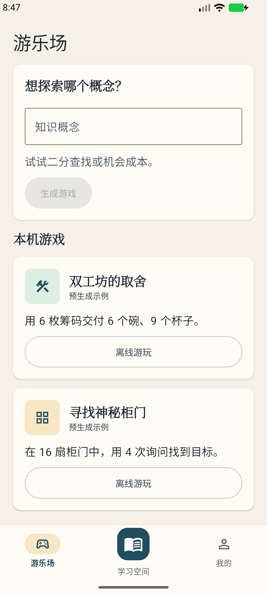
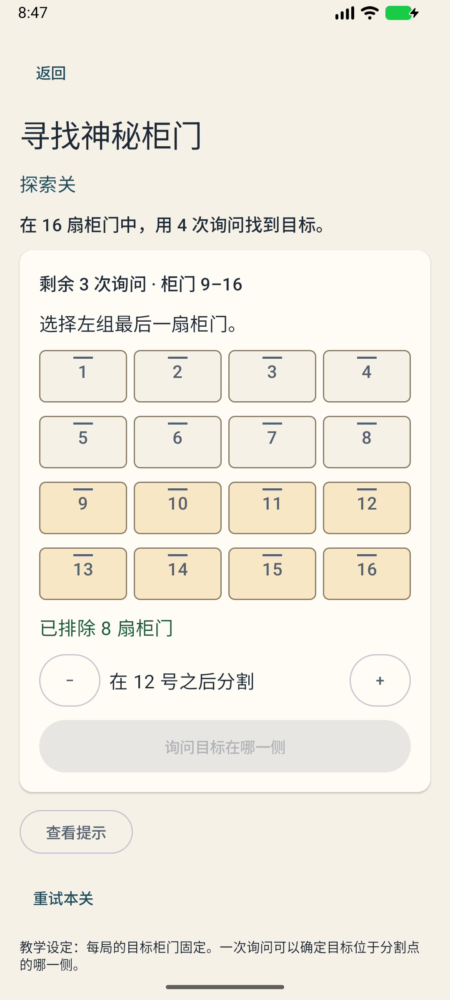
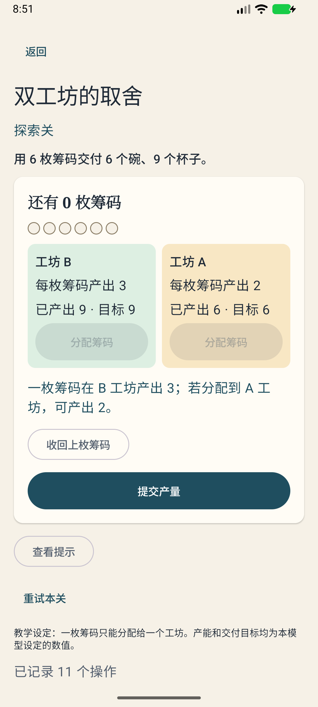
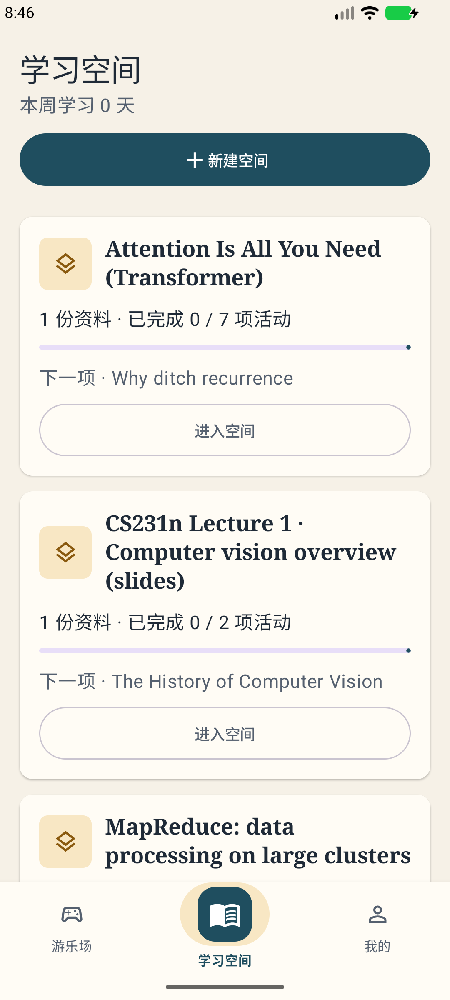
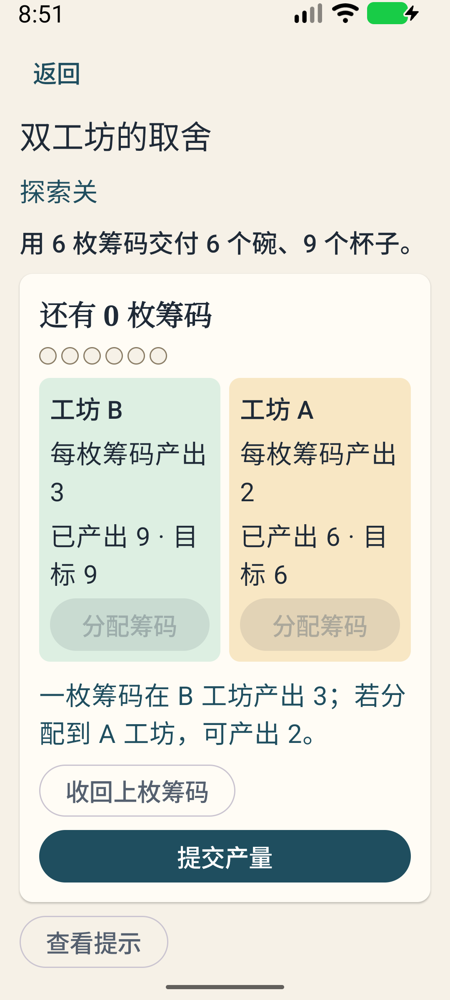
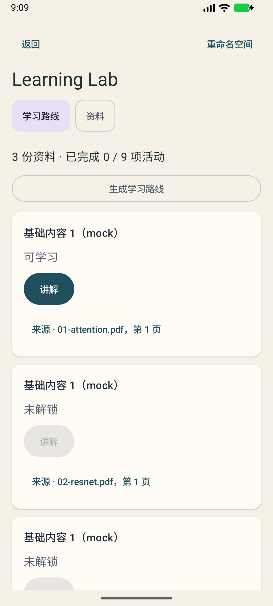
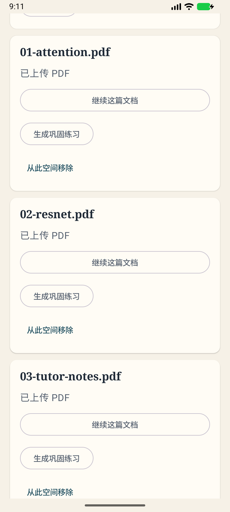
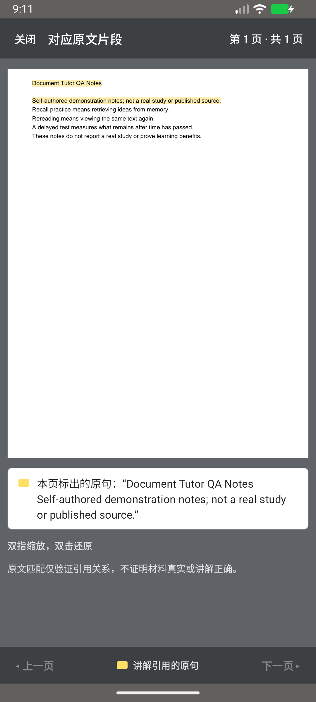
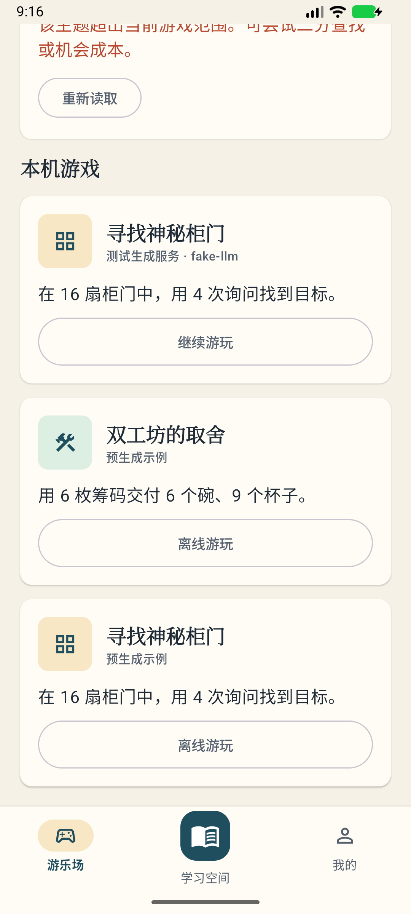
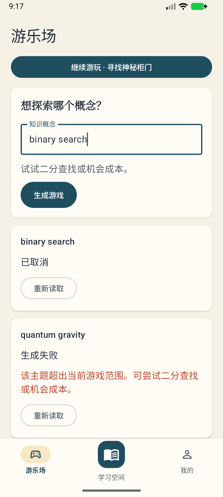

# Actual Android screenshots — 2026-11-23

Unaltered captures from the debug APK on the dedicated API 37 arm64 emulator (1080 × 2400). The sample profile was upgraded in place from the original APK. These are application screens, not design mockups. See the [acceptance record](../../concept-games-spaces-acceptance.md) for scenarios and limits.

| Playground | Partition game | Resource allocation |
|---|---|---|
|  |  |  |

| Migrated Spaces | Shared progress | Large text |
|---|---|---|
|  |  |  |

Additional captures: [transfer completion](03-partition-complete-zh.png), [large-text Me](06-me-large-text-zh.png), [English Playground](07-playground-en.png). The reproducible game acceptance results are in [games-result.json](games-result.json).

| Three-PDF route | Materials | Correct PDF source |
|---|---|---|
|  |  |  |

The route uses the explicit fake provider: `mock` labels are visible. The source screenshot shows the repository-authored test PDF, not a third-party paper. More evidence: [upload confirmation](12-multi-pdf-confirmation.png), [independent file outcomes](13-import-results.png), [local-material exclusions](15-route-exclusions.png), [retained Rookie](10-legacy-rookie.png), [retained Escape](11-legacy-escape.png).

| Generated native game | Unsupported topic | In-flight cancellation |
|---|---|---|
|  |  |  |

[PDF Tutor explanation](20-notes-tutor.png) uses the repository-authored notes. Successful generation uses explicit fake fixtures; cancellation used a controlled loopback delay endpoint. Neither establishes live-model educational quality.

[External PDF sharing confirmation](24-external-share-confirmation.png) remains visible above a previously scrolled Materials list after rotation.
