# Spaces learning map — 2026-11-23

Roborazzi captures from the unit-test renderer (393 × 852 dp at 3x, Robolectric native graphics), produced by `SpacesMapScreenshotTest`. They show the Route tab of a Space as a winding path of nodes grouped into units, replacing the list of cards in [17-three-pdf-route](../2026-11-23-concept-games-spaces/17-three-pdf-route.png). Lin is the sample student; the map opens at the unit of the next step.

| Lin's Attention Space (opens at the next step) | Whole Attention map | Chinese Space with progress |
|---|---|---|
| 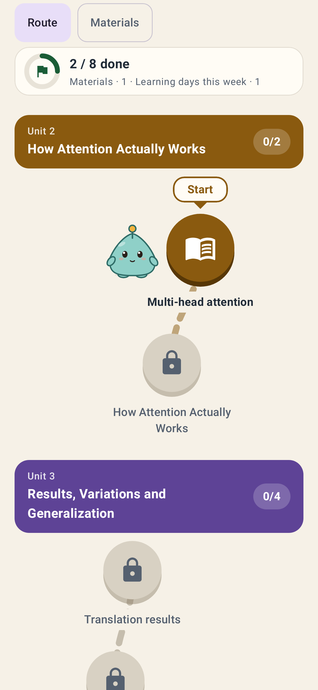 | 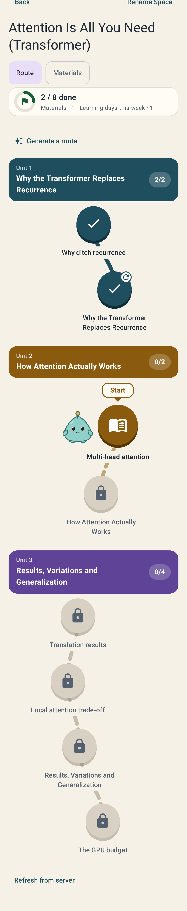 | 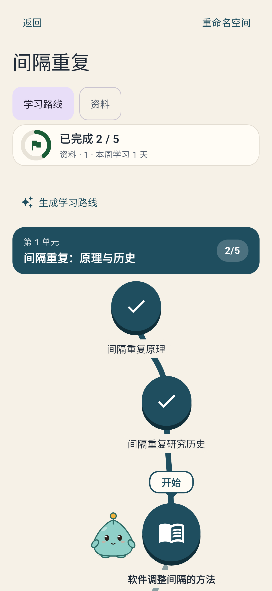 |

| Node sheet | Locked node | Empty Space |
|---|---|---|
| 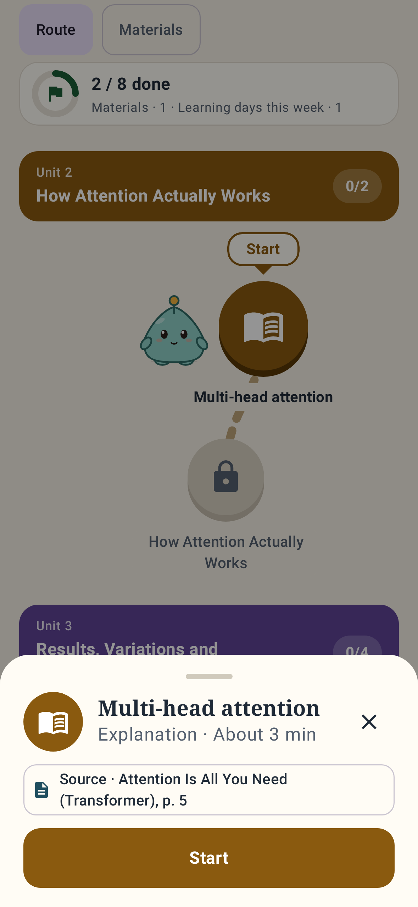 | 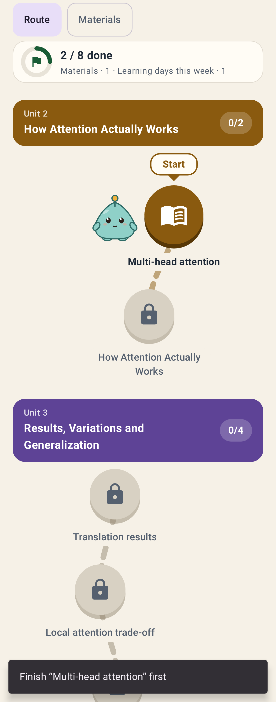 | 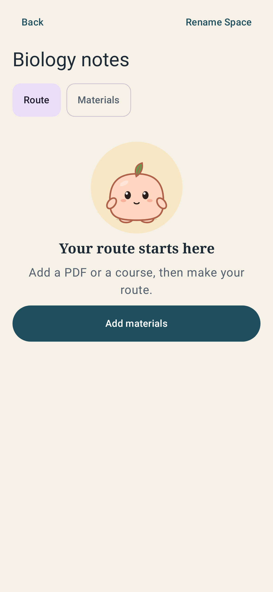 |

| Continue a practice (ResNet, Chinese UI) | Font scale 2.0 | Landscape |
|---|---|---|
| 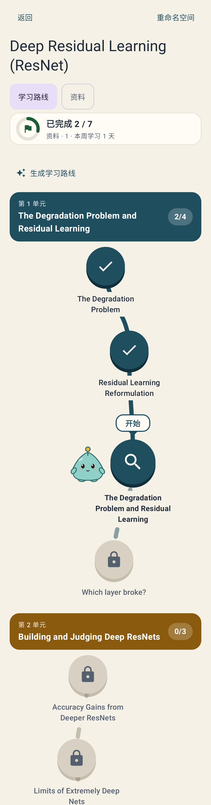 | 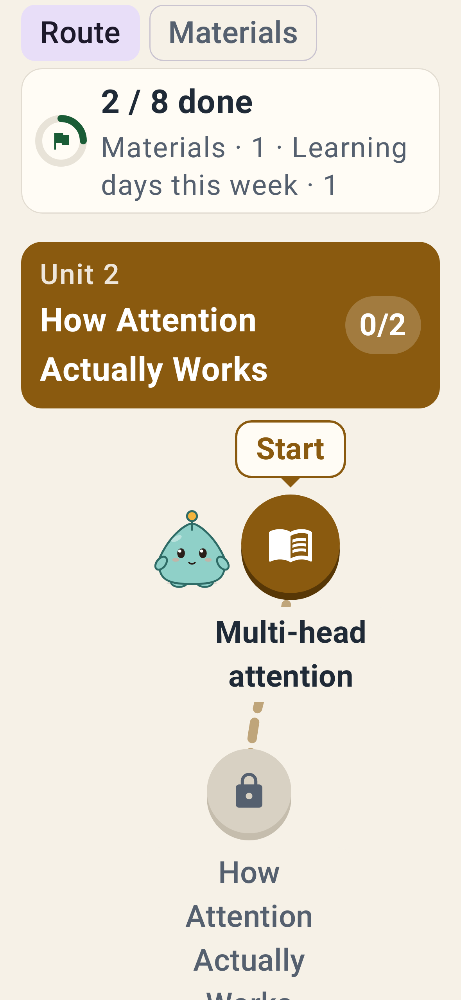 | 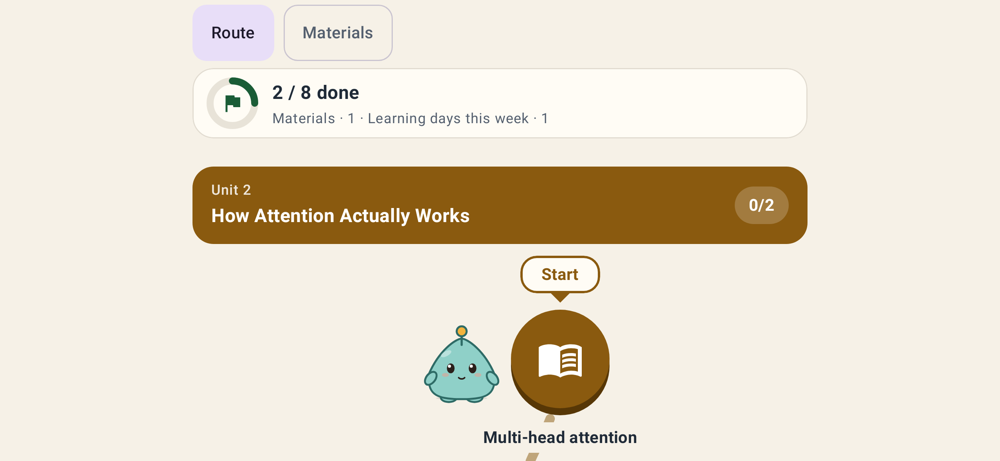 |

| Spaces list, English UI | Spaces list, Chinese UI |
|---|---|
| 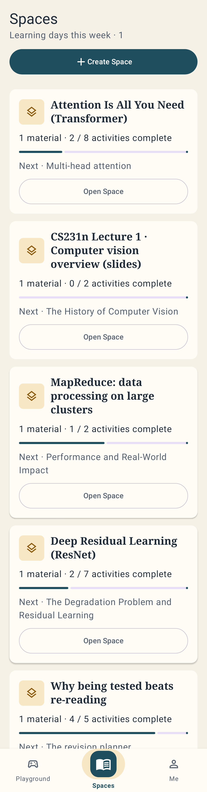 | 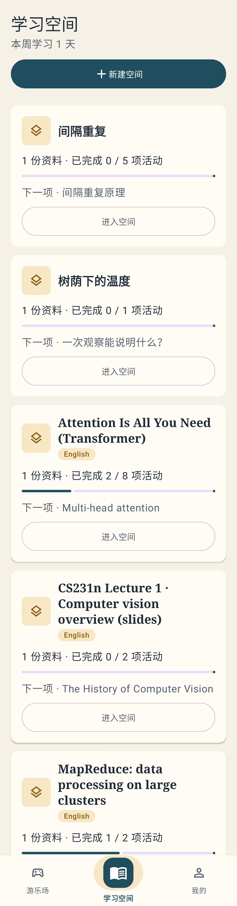 |

The tabs and the progress strip are one sticky header: the strip stays in view while the map scrolls. Preset routes include one related Playground game step per Space (for example ResNet: "Which layer broke?"); finishing it from the route offers "Back to <Space>" ([p20](../playground/p20_completed_from_route_en.png)).

Step titles are the course's own concept and level names. Test generators once put "(mock)" in every concept title; the map removes that suffix from old saved titles and shows a "Test content" badge on the unit instead.
