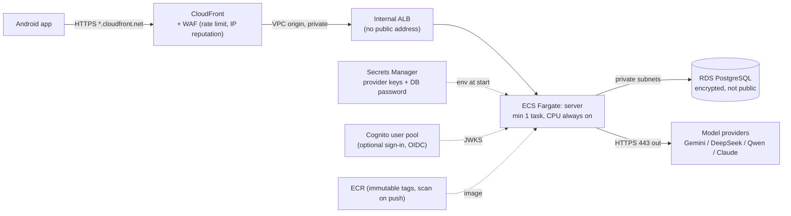

# infra — infrastructure as code

**Scope**: how the server is deployed, as Terraform. Why Terraform and why this shape: [ADR-012](../docs/architecture/decisions.md), [portability audit](../docs/architecture/portability-audit.md). Nothing here is applied automatically; `apply` is a deliberate step by the owner.

## Layout

```
infra/
├── terraform/
│   ├── modules/
│   │   └── aws-service/     one cloud = one module; every <cloud>-service module has the SAME inputs and outputs
│   └── envs/
│       └── demo-aws/        picks a module + region + settings; switching cloud = switching the module source
└── scripts/
    ├── check.sh             fmt + validate + Trivy misconfiguration scan (no credentials needed)
    └── push-image.sh        build the server image and push it to the module's registry
```

The **module interface** (the multi-cloud seam):

| Inputs | Outputs |
|---|---|
| `name`, `environment`, `image_tag`, `container_port`, `cpu`, `memory`, `min_instances`, `running`, `env` (plain settings), `secret_keys` (secret settings), `db_tier`, `db_storage_gb`, `deletion_protection`, `enable_auth`, `auth_redirect_uris`, `budget_email`, `budget_limit_usd` | `base_url`, `image_repository`, `app_secret_id`, `oidc_issuer`, `oidc_client_id`, `auth_domain`, `logs` |

The **container contract** (the code ↔ infrastructure seam, `server/README.md`): one image; listens on `PORT`/`A2G_PORT`; all settings as env vars; stateless; logs to stdout; `/v1/health` and `/v1/ready`. A `gcp-service` module would map the same interface onto Cloud Run + Cloud SQL + Secret Manager + Artifact Registry + Identity Platform; the server image does not change.

## What `aws-service` builds



| Concern | Decision |
|---|---|
| Public surface | Only CloudFront (HTTPS). The ALB is internal and reached through a CloudFront **VPC origin**; tasks accept traffic only from the ALB's security group; the database only from the tasks. |
| Abuse / cost | WAF per-IP rate limit (default 600 requests / 5 min) + AWS IP reputation list; server-side quotas; monthly budget alert. |
| Secrets | Provider keys live in one Secrets Manager secret whose **value is set outside Terraform** (never in state, code or tfvars). The DB password is generated and rotated by RDS. Tasks read exactly these two secrets. |
| Least privilege | Execution role: pull image, write logs, read the two secrets. Task role: **no permissions** — the server calls no AWS API. |
| No NAT gateway | Tasks sit in public subnets with a public IP for *outbound* calls only (saves ~USD 32/month); their security group admits nothing but the ALB. |
| Sign-in | Cognito public client (Authorization Code + PKCE, no client secret in the APK). Anonymous play stays the default; the server verifies tokens via standard OIDC/JWKS, so any OIDC provider works. |
| Data safety | Deletion protection on by default (DB + user pool), 7-day backups, final snapshot unless protection is off. |

Accepted scanner findings (annotated in code with `#trivy:ignore` and the reason): internal HTTP listener behind the VPC origin (TLS ends at CloudFront until we own a domain); 443 egress to any address (model providers have no fixed IPs); no CloudFront access logs (cost, client IPs); no IAM DB auth (the server uses the RDS-managed rotated password, no cloud SDK); VPC flow logs off by default (`enable_flow_logs`).

## Cost (rough, Singapore, 24×7 — check the AWS Pricing Calculator)

| Item | ≈ USD / month |
|---|---|
| Fargate 0.5 vCPU / 1 GB, 1 task | 18 |
| Application Load Balancer | 18 |
| RDS db.t4g.micro + 20 GB gp3 (free tier may cover it in a new account) | 15 |
| WAF (ACL + 2 rules) | 7 |
| Public IPv4 for the task, Secrets Manager, CloudWatch, CloudFront at demo traffic | 5 |
| **Total** | **≈ 60** (≈ USD 2/day) |

Set `running = false` between demos (scales the server to 0; the database keeps the data). Model tokens are billed by the providers, not AWS.

## Deploy (owner, with a personal or team AWS account — never a work account)

Prerequisites: Terraform ≥ 1.10, AWS CLI v2 logged in to the **target** account, Docker. Run `infra/scripts/check.sh` first.

```sh
cd infra/terraform/envs/demo-aws
cp terraform.tfvars.example terraform.tfvars        # edit region, budget_email, models (no keys here)

# 1. Registry first, so there is somewhere to push the image.
terraform init
terraform apply -target=module.service.aws_ecr_repository.server

# 2. Build + push the server image; note the printed tag and put it in terraform.tfvars (image_tag).
../../../scripts/push-image.sh ap-southeast-1

# 3. Review the full plan. This creates the public HTTPS endpoint — read it before approving.
terraform plan -out plan.tfplan
terraform apply plan.tfplan

# 4. Put the provider keys into the secret (JSON keys = secret_keys), then restart the service to pick them up.
aws secretsmanager put-secret-value --secret-id "$(terraform output -raw app_secret_id)" \
  --secret-string file://<path-to-local-keys.json>   # e.g. {"A2G_COMPILE_API_KEY":"…"}; keep the file out of git
aws ecs update-service --cluster a2g-demo --service server --force-new-deployment

# 5. Verify.
curl -s "$(terraform output -raw base_url)/v1/health"      # 200 expected
```

Verify the private parts stay private: the ALB has no public DNS resolution from outside the VPC, and the database endpoint resolves to private addresses only. If anything restricted answers from the internet, stop and fix before sharing the URL.

Tear down: set `deletion_protection = false`, `apply`, then `destroy`.

## Upgrade path

| When | Change |
|---|---|
| We own a domain | ACM certificate on the ALB (HTTPS listener) + `origin_protocol_policy = "https-only"`; alias the domain to CloudFront |
| Team-shared state | S3 backend with `use_lockfile = true` (snippet in `envs/demo-aws/main.tf`) |
| More traffic | `min_instances` > 1 (the job queue is lease-based, safe for several instances), RDS `multi_az`, NAT gateway + private task subnets |
| Second cloud | `modules/gcp-service` with the same variables/outputs; new `envs/demo-gcp` |
| CI | run `scripts/check.sh` on every PR touching `infra/`; `push-image.sh` + `terraform plan` on merge |
